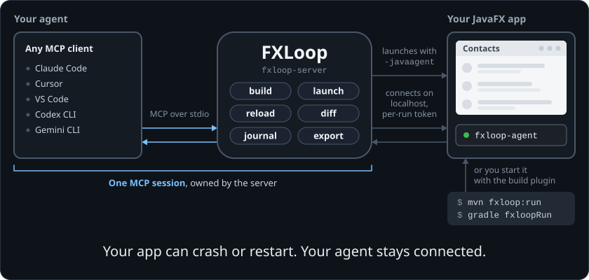

<div align="center">

# FXLoop

**Let your coding agent see, click and fix your JavaFX app.**

An MCP server for JavaFX: any MCP agent can screenshot, drive, explain and live-reload your running app.
Java or Kotlin, Maven or Gradle.

[](LICENSE)


[Quickstart](#quickstart) · [What you can ask](#what-you-can-ask) · [Features](#features) · [Docs](#documentation)

</div>

A coding agent building a web app has a browser to look at and click. Building a JavaFX app, it compiles and asks you
what happened on screen. FXLoop gives it a copy of your app to look at and drive, and explains why the UI looks the way
it does, so the agent fixes the cause instead of guessing at CSS and layout.

<p align="center">
  
</p>

## Quickstart

**You need** a JDK 21+ (on your `PATH`, or from a version manager such as mise or SDKMAN) and a JavaFX app built with
Maven or Gradle.

### With your agent

FXLoop starts your app for the agent. Install the FXLoop skills (needs Node.js 22.20+):

```sh
npx skills add h9lxyz/fxloop -g -y
```

Then open your agent in your app's project and ask:

> Connect FXLoop to this project and show me the app.

The agent downloads the server, registers it and asks you to restart the agent once. Say "continue" and it launches
your app and shows you a screenshot; the first launch compiles your project, which can take a few minutes. It doesn't touch your build files; the few files it adds (agent config, a note in `CLAUDE.md` or
`AGENTS.md`) stay uncommitted for you to review. To try it on a demo first, use
[Ticket Desk](sample-apps/fxloop-showcase-app/README.md#running-a-demo), a small app with UI bugs planted on purpose.

No Node.js, or an agent without skills? Paste this instead; it needs only the JDK:

> Set up FXLoop in this project by following https://raw.githubusercontent.com/h9lxyz/fxloop/main/INSTALL.md

### With the Maven plugin

You start the app yourself, no agent needed. FXLoop isn't on Maven Central yet, so download it once and copy its plugin
into your local Maven repository (on Windows, type `curl.exe`):

```sh
curl -fsSL --create-dirs -o "$HOME/.fxloop/fxloop-server.jar" https://github.com/h9lxyz/fxloop/releases/download/0.0.1/fxloop-server-all.jar
java -jar "$HOME/.fxloop/fxloop-server.jar" --seed-local-repo
```

Add the plugin to your `pom.xml`, under `<build><plugins>`:

```xml
<plugin>
  <groupId>org.lab59.fxloop</groupId>
  <artifactId>fxloop-maven-plugin</artifactId>
  <version>0.0.1</version>
</plugin>
```

Start your app (`mvn fxloop:run` if your project has no Maven wrapper):

```sh
./mvnw fxloop:run
```

Your window gets the FXLoop dev bar. **Pick** a node, or click **Open CSS inspector** to inspect it in your browser,
try CSS live and save it into your stylesheet. An agent can join later: connect it as above and it attaches to this
window instead of launching a second copy. For Gradle (`./gradlew fxloopRun`), see [Add the build plugin](INSTALL.md#add-the-build-plugin-optional).

<p align="center">
  
</p>

## What you can ask

| You say | What happens |
|---|---|
| "Show me the app" | Launches the app and shares a screenshot |
| "Review this screen, what looks off?" | Ranked findings: truncated text, overlaps, low contrast, misalignment |
| "The panel doesn't resize" | Finds the layout cause and fixes it, with before and after screenshots |
| "Add dark mode" | Restyles with CSS, reloaded live while you watch |
| "Is this keyboard friendly?" | Walks the Tab order and measures contrast ratios |
| "Does it work at 1024×640? In German?" | Relaunches with each setting and lints every frame |
| "Make sure this doesn't regress" | Writes a JUnit 5 + TestFX test from what was clicked |

## Features

- **See**: screenshots of any window or node, pixel diffs, and the scene graph as JSON.
- **Drive**: real or synthetic clicks and typing; each action reports what changed.
- **Explain**: why a node has its size, its color (the winning CSS rule with `file:line`) or its disabled state.
- **Catch**: lint for truncated, overlapping, off-screen and low-contrast nodes, plus UI-thread exceptions and logs.
- **Reload live**: CSS in milliseconds, FXML in place, method bodies hot-swapped; bigger changes restart on the same screen.
- **Lock in**: turns what was clicked into a headless JUnit 5 + TestFX test.
- **Stays out of production**: nothing is added to your app; the plugin's guard fails the package if FXLoop leaks in.

There are nearly forty `fx_*` tools; the [MCP server overview](docs/mcp.md) groups them by job, and the
[tool reference](docs/tools.md) lists every parameter.

## Troubleshooting

Start with the doctor. It checks your JDK, build, JavaFX, main class, display and agent config, and changes nothing:

```sh
java -jar "$HOME/.fxloop/fxloop-server.jar" doctor
```

If the `fx_*` tools don't show up, start a new agent session: a running session doesn't see new servers. More in the
[troubleshooting guide](docs/troubleshooting.md).

## How it works

<p align="center">
  
</p>

The server builds your project with its own Maven or Gradle wrapper and launches the app with a small in-JVM agent, or
connects to the app you started with the plugin. The server owns the MCP session, so your app can crash or restart
without the agent losing its connection.

## Compatibility

| | |
|---|---|
| **Agents** | Claude Code, Cursor, VS Code (Copilot), Codex CLI, Gemini CLI, any stdio MCP client |
| **Apps** | Java or Kotlin, Maven or Gradle, FXML or code-built UI, classpath or module path |
| **Runtime** | JDK 21+ with JavaFX 21, 25 or 27; JetBrains Runtime adds structural hot-swap |
| **Displays** | A desktop, or headless on Xvfb or Monocle ([CI templates](docs/ci/README.md)) |
| **OS** | Linux, Windows and macOS, all tested in CI |

FXLoop is at its first `0.0.x` releases. Know the [limitations](docs/limitations.md) before you rely on it.

## Documentation

- [Install guide](INSTALL.md): every step by hand, with the config for each agent
- [MCP server overview](docs/mcp.md), [tool reference](docs/tools.md), [agent skills](docs/skills.md)
- [Configuration](docs/configuration.md), [troubleshooting](docs/troubleshooting.md), [CI and headless](docs/ci/README.md)
- [Security](docs/security.md), [limitations](docs/limitations.md), [design notes](docs/design/) for contributors

## Contributing and license

Build instructions are in [CONTRIBUTING.md](CONTRIBUTING.md). FXLoop is licensed under [Apache-2.0](LICENSE).
