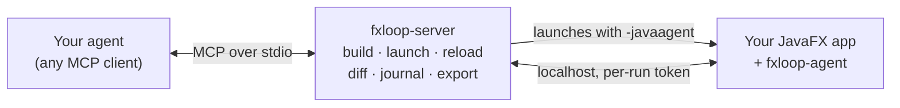

<div align="center">

# FXLoop

**Let your coding agent see, click and fix your JavaFX app.**

FXLoop gives Claude Code, Cursor, Copilot, Codex, Gemini or any other MCP agent a running copy of your JavaFX app to
look at and drive, explains why the UI looks the way it does, and live-reloads the fix. Java or Kotlin, Maven or
Gradle.

[](LICENSE)


[Quickstart](#quickstart) · [What you can ask](#what-you-can-ask) · [Features](#features) ·
[Troubleshooting](#troubleshooting) · [Docs](#documentation)

</div>

---

When an agent builds a web app, it has a browser: it can look at the page, click it and read the console. When it
builds a JavaFX app, it edits code blind and asks you what happened on screen. **FXLoop is the browser for JavaFX.**
The agent gets screenshots, clicks, layout and CSS explanations, and live reload, so it can check its own work.

```text
You    The Save button in the contact dialog gets cut off when the window is small.

Agent  fx_take_screenshot            → screens/14-before-save.png
       fx_lint_visual                → textTruncated  Button#saveBtn  "Sa…"
       fx_explain_layout #saveBtn    → in an HBox, prefWidth=60 set in FXML
       edit contact-dialog.fxml      → drop prefWidth, let the spacer grow
       fx_reload                     → FXML swapped live, view state kept
       fx_compare_screenshots        → 1 changed region, lint clean

       Fixed. Before and after screenshots are in target/fxloop/screens/.
```

<sub>An illustrative session, tool output shortened.</sub>

## Quickstart

**You need:** a JDK 17+ on your `PATH` (a JDK, not a JRE), a JavaFX app built with Maven or Gradle, and an agent
that speaks MCP. No clone, no build, and no change to your project is required.

### Option A: let your agent set it up

Open your agent in your app's project and paste:

> Set up FXLoop in this project by following https://raw.githubusercontent.com/h9lxyz/fxloop/main/INSTALL.md

[INSTALL.md](INSTALL.md) walks the agent through every step: it checks your JDK, downloads the server, registers it,
installs the skills, and asks you to restart the agent once. Then it shows you a screenshot of your app. The page
reads fine for humans too.

### Option B: three commands

**1. Download the server**, a single jar in `~/.fxloop/`:

```sh
# bash / zsh
mkdir -p ~/.fxloop && curl -fsSL -o ~/.fxloop/fxloop-server.jar \
  https://github.com/h9lxyz/fxloop/releases/latest/download/fxloop-server-all.jar
java -jar ~/.fxloop/fxloop-server.jar --version
```

<details>
<summary>Windows (PowerShell)</summary>

```powershell
New-Item -Force -ItemType Directory "$HOME\.fxloop" | Out-Null
Invoke-WebRequest -OutFile "$HOME\.fxloop\fxloop-server.jar" `
  https://github.com/h9lxyz/fxloop/releases/latest/download/fxloop-server-all.jar
java -jar "$HOME\.fxloop\fxloop-server.jar" --version
```

</details>

`--version` should end with `OK`. If it does not, it tells you what is wrong with your JDK.

**2. Register it with your agent.** Run this in your app's project:

```sh
claude mcp add fxloop -- java -jar ~/.fxloop/fxloop-server.jar
```

On Windows, use `"$HOME\.fxloop\fxloop-server.jar"` as the path. For Cursor, VS Code, Codex CLI or Gemini CLI, copy
the config from [INSTALL.md step 5](INSTALL.md#5-register-the-server-with-your-agent), or let the server print it
for you with `java -jar ~/.fxloop/fxloop-server.jar doctor --client=cursor` (or `vscode`, `codex`, `gemini`).

**3. Start a new agent session in the project and ask:**

> Show me the app.

The first request compiles your project, launches the app and takes a screenshot. That takes 30 seconds to a few
minutes the first time; after that, answers are instant.

### Optional: add the skills

The skills are ten ready-made workflows for UI work: reviews, layout fixes, theming, accessibility and more. They
start from plain requests, so you never call them by name.

```sh
curl -fsSL -o /tmp/fxloop-skills.zip \
  https://github.com/h9lxyz/fxloop/releases/latest/download/fxloop-skills.zip \
  && unzip -o /tmp/fxloop-skills.zip -d ~/.claude/skills/
```

<details>
<summary>Windows (PowerShell)</summary>

```powershell
Invoke-WebRequest -OutFile "$env:TEMP\fxloop-skills.zip" `
  https://github.com/h9lxyz/fxloop/releases/latest/download/fxloop-skills.zip
Expand-Archive -Force "$env:TEMP\fxloop-skills.zip" "$HOME\.claude\skills\"
```

</details>

For other agents, unzip into their skills directory instead. Then ask **"connect FXLoop to this project and show me
the app"**. The `fxloop-connect` skill also adds the FXLoop build plugin and a guard that keeps FXLoop out of your
release builds.

### Try it on the sample app first

The repo ships a small helpdesk app with UI bugs planted on purpose:

```sh
git clone https://github.com/h9lxyz/fxloop.git && cd fxloop/sample-apps/fxloop-showcase-app
claude mcp add fxloop -- java -jar ~/.fxloop/fxloop-server.jar
claude
```

Then ask *"review the main window, what looks off?"* and *"the detail panel doesn't resize, fix it"*. The list of
planted bugs is in `ISSUES.md`; don't show it to the agent.

## What you can ask

Once FXLoop is connected, talk to your agent the way you would talk to a colleague looking at your screen:

| You say | What happens |
|---|---|
| "Show me the app" | Launches the app and shares a screenshot |
| "Review this screen, what looks off?" | Ranked findings: truncated text, overlaps, low contrast, misalignment |
| "The panel doesn't resize" / "the buttons are squashed" | Finds the layout cause and fixes it, with before and after screenshots |
| "Make it look modern" / "add dark mode" | Restyles with CSS, reloaded live while you watch |
| "Is this keyboard friendly? Check the contrast" | Walks the Tab order and measures contrast ratios |
| "Does it work at 1024×640? In German? Right-to-left?" | Resizes and relaunches with each setting, and lints every frame |
| "Creating a ticket feels clunky" / "it freezes on refresh" | Clicks through the flow and fixes friction and UI-thread blocking |
| "Clean up this dialog" / "Escape doesn't close it" | Fixes tab order, Enter and Escape, sizing and validation |
| "Make all screens look the same" | Moves shared styles into one stylesheet |
| "Make sure this doesn't regress" | Writes a JUnit 5 + TestFX test from what was clicked |

The last seven rows are the [agent skills](docs/skills.md). Without them the agent still has every tool and works
out the steps itself.

## Features

| | |
|---|---|
| 👀 **See** | Screenshots of any window or node, with numbered markers. Pixel diffs between frames, hover, focus and pressed states in one image, and the scene graph as JSON. Every screenshot is saved, so you see what the agent saw |
| 🖱️ **Drive** | Real clicks and typing, or synthetic events while you keep using your mouse. Every action reports what changed: a dialog opened, a button got disabled, or nothing happened |
| ❓ **Explain** | Why a node has its size: constraints, grow rules, margins. Why it has its color: the winning CSS rule with `file:line` and the smallest override that beats it. Why it is disabled: the binding chain |
| 🔍 **Catch** | Visual lint for truncated text, overlaps, off-screen and zero-size nodes, and low contrast. FXML checked against your controllers before launch. UI-thread exceptions and logs |
| ⚡ **Reload live** | CSS in milliseconds, FXML swapped in place with state kept, method bodies hot-swapped (Java and Kotlin). Bigger changes restart the app and click back to the same screen |
| 🧪 **Lock in** | Turns what was clicked into a JUnit 5 + TestFX test that runs headless |
| 🤝 **Work alongside you** | A dev bar on the app window shows what the agent is doing. Click **Pick** on a node and ask "why is *this* grey?", or open a DevTools-style CSS inspector in your browser |
| 🔒 **Stay out of production** | Nothing is added to your app. The agent attaches only at dev launch, listens on localhost with a per-run token, and a build guard fails the package if FXLoop ever leaks in |

There are nearly forty `fx_*` tools; the [MCP server overview](docs/mcp.md) groups them by job, and the
[tool reference](docs/tools.md) lists every parameter.

## Run the app yourself

Prefer to start the app on your own and bring the agent in later? Add the FXLoop build plugin, then click around,
**Pick** the node that bothers you and ask your agent about it. The agent connects to your window instead of
launching a second copy, and it leaves your mouse alone.

<details>
<summary>Set up <code>fxloop:run</code> / <code>fxloopRun</code></summary>

FXLoop isn't on Maven Central or the Gradle Plugin Portal yet, so first copy its plugins into your local Maven
repository. This writes only `~/.m2/repository/dev/fxloop/`; re-run it after you update the jar:

```sh
java -jar ~/.fxloop/fxloop-server.jar --seed-local-repo
```

**Maven**, under `<build><plugins>` in `pom.xml`:

```xml
<plugin>
  <groupId>dev.fxloop</groupId>
  <artifactId>fxloop-maven-plugin</artifactId>
  <version>1.0.0-SNAPSHOT</version>
</plugin>
```

**Gradle**, in `plugins {}` of `build.gradle.kts`, and add `mavenLocal()` to both repository blocks of
`settings.gradle.kts` ([snippet](INSTALL.md#7-add-the-build-plugin-and-the-guard-optional)):

```kotlin
id("dev.fxloop") version "1.0.0-SNAPSHOT"
```

Then run:

```sh
./mvnw fxloop:run        # Gradle: ./gradlew fxloopRun
```

On a machine without a display, wrap the command in `xvfb-run -a`. The production guard snippet and more options
are in [INSTALL.md step 7](INSTALL.md#7-add-the-build-plugin-and-the-guard-optional) and the
[configuration guide](docs/configuration.md#running-the-app-yourself).

</details>

## Troubleshooting

Start with the doctor. It checks your JDK, build, JavaFX setup, main class, display and agent config, gives a
one-line fix for each problem, and changes nothing:

```sh
java -jar ~/.fxloop/fxloop-server.jar doctor
```

| Problem | Fix |
|---|---|
| The `fx_*` tools don't show up | Start a new agent session after registering; a running session doesn't see new servers |
| "Cannot determine the main class" | Add `main-class=com.example.Main` to `fxloop.properties` in your project root |
| No screen (SSH, a container, CI) | Add `headless=xvfb` to `fxloop.properties` |
| The download is blocked (proxy, firewall) | Get `fxloop-server-all.jar` any other way and save it as `~/.fxloop/fxloop-server.jar` |
| `BUILD_FAILED` with `429` or `Could not resolve` | Your dependency cache is cold and the repository is slow. Wait a moment and ask again |

More answers are in the [troubleshooting guide](docs/troubleshooting.md).

## How it works



The server builds your project with its own Maven or Gradle wrapper, finds the main class, and launches the app with a
small in-JVM agent. Because the server owns the MCP session, your app can crash, restart or be hot-swapped without
the agent losing its connection.

## Compatibility

| | |
|---|---|
| **Agents** | Claude Code, Cursor, VS Code (Copilot agent mode), Codex CLI, Gemini CLI, any stdio MCP client |
| **Apps** | Java or Kotlin, Maven or Gradle, FXML or code-built UI, classpath or module path |
| **Runtime** | JDK 17+ with JavaFX 21, 25 or 27. JetBrains Runtime unlocks structural hot-swap (new methods and fields) |
| **Displays** | A desktop, or headless on Xvfb or Monocle for SSH, devcontainers and CI ([templates](docs/ci/README.md)) |
| **OS** | Linux is tested in CI; macOS and Windows are configured in CI but not yet run |

FXLoop is at its first `0.0.x` releases. Know the [limitations](docs/limitations.md) before you rely on it.

## Documentation

| Guides | Reference | Design |
|---|---|---|
| [Install (step by step)](INSTALL.md) | [Tool reference](docs/tools.md) | [Architecture](docs/00-overview.md) |
| [MCP server overview](docs/mcp.md) | [Configuration](docs/configuration.md) | [Implementation status](docs/05-implementation-tracking.md) |
| [Agent skills](docs/skills.md) | [Troubleshooting](docs/troubleshooting.md) | [Decisions](docs/decisions/) |
| [CI and headless](docs/ci/README.md) | [Security](docs/security.md), [Limitations](docs/limitations.md) | PRDs in [docs/](docs/) |

Browse the docs as a site with `mkdocs serve`.

## Contributing

<details>
<summary>Build, test and repository layout</summary>

```sh
git clone https://github.com/h9lxyz/fxloop.git && cd fxloop
./mvnw install                  # the FXLoop modules; UI tests run headless, no display needed
./mvnw install -Psamples        # plus the sample apps and their tests (what CI builds)
./mvnw install -Pacceptance     # plus the end-to-end MCP suite
```

For Gradle apps against a local build, also run `./fxloop-gradle-plugin/gradlew -p fxloop-gradle-plugin
publishToMavenLocal`, then `./mvnw install -DskipTests -pl fxloop-server` so the server bundles the plugin. Your
build is `fxloop-server/target/fxloop-server-1.0.0-SNAPSHOT-all.jar`; register that path instead of
`~/.fxloop/fxloop-server.jar`. Releases are cut by pushing a `x.y.z` tag.

`docs/tools.md` is generated from the tool registry (`java -jar fxloop-server/target/fxloop-server-*-all.jar
--tool-reference`); don't edit it by hand.

| Module | What it is |
|---|---|
| `fxloop-server` | The stdio MCP server (shaded `-all.jar`): builds, launches, supervises, reloads |
| `fxloop-agent` | The in-JVM agent: scene graph, input, reload, FXML registry |
| `fxloop-protocol` | The protocol between server and agent, and the `launch.json` schema |
| `fxloop-launch` | Main-class and launch-mode detection shared by the server and both build plugins |
| `fxloop-dev` | Optional dev dependency for IDE-launched apps ([decision](docs/decisions/fxml-load-registry.md)) |
| `fxloop-maven-plugin` | `fxloop:run` and `fxloop:prepare` ([README](fxloop-maven-plugin/README.md)) |
| `fxloop-gradle-plugin` | Gradle plugin `dev.fxloop`, a standalone Gradle build ([README](fxloop-gradle-plugin/README.md)) |
| `fxloop-skills` | The agent skills, shared references and evals ([README](fxloop-skills/README.md)) |
| `sample-apps/*` | Test apps, including `fxloop-showcase-app` with planted UI bugs |
| `fxloop-acceptance` | End-to-end suite that drives the server over MCP |

The tooling is written in Kotlin and targets Java 17 bytecode.

</details>

## License

Apache-2.0, see [LICENSE](LICENSE).
