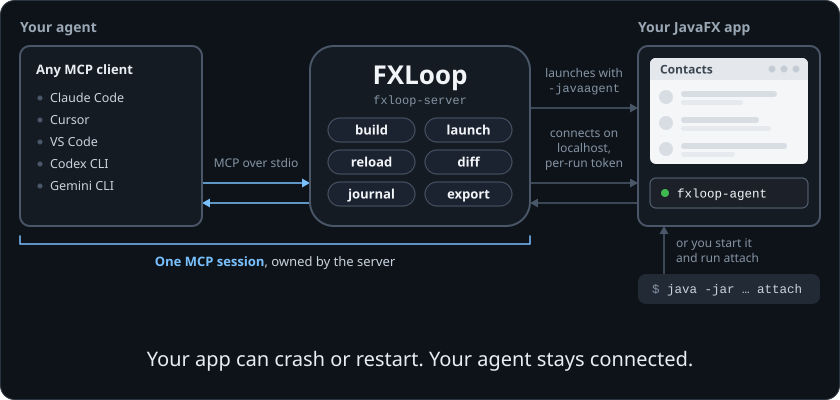

<div align="center">

# FXLoop

**Let your coding agent see, click and fix your JavaFX app.**

An MCP server for JavaFX: any MCP agent can screenshot, drive, explain and live-reload your running app.
Java or Kotlin, Maven or Gradle.

[](LICENSE)


[](https://github.com/h9lxyz/fxloop/actions/workflows/ci.yml)

[Quickstart](#quickstart) · [What you can ask](#what-you-can-ask) · [Features](#features) · [How it works](#how-it-works) · [Docs](#documentation)

</div>

A coding agent building a web app has a browser to look at and click. Building a JavaFX app, it compiles and asks you
what happened on screen. FXLoop gives it a copy of your app to look at and drive, and explains why the UI looks the way
it does, so the agent fixes the cause instead of guessing at CSS and layout.

<p align="center">
  
</p>

## Quickstart

**Requires:** JDK 21+ and a JavaFX app built with Maven or Gradle. (Your build files stay untouched.)

### Option 1: With your coding agent

Works with Claude Code, Cursor, VS Code (Copilot), Codex CLI, Gemini CLI, and any stdio MCP client.

1. Install the FXLoop skills (requires Node.js 22.20+):

   ```sh
   npx skills add h9lxyz/fxloop -g -y
   ```

2. Open your agent in your JavaFX project and ask:

   > Connect FXLoop to this project and show me the app.

The agent downloads the server jar, configures MCP (reload your agent once when prompted, then say "continue"), compiles
your project on first launch, and returns a screenshot. Uncommitted config files stay for you to review;
[uninstall cleanly](INSTALL.md#uninstall) anytime.

<details>
<summary>No Node.js, or prefer manual setup?</summary>

If your agent can fetch URLs and run shell commands (needs JDK 21+ only), paste this prompt instead:

> Set up FXLoop in this project by following https://raw.githubusercontent.com/h9lxyz/fxloop/main/INSTALL.md

Or follow the step-by-step instructions (including config snippets for each client) in [INSTALL.md](INSTALL.md).

</details>

### Option 2: Standalone live CSS inspector (`attach`)

No agent needed and no changes to your build.

1. Download the server jar once (on Windows, type `curl.exe`):

   ```sh
   curl -fsSL --create-dirs -o "$HOME/.fxloop/fxloop-server.jar" https://github.com/h9lxyz/fxloop/releases/latest/download/fxloop-server-all.jar
   ```

2. Start your JavaFX app as usual (your IDE's Run button, `mvn javafx:run`, `gradle run`), then attach:

   ```sh
   java -jar "$HOME/.fxloop/fxloop-server.jar" attach
   ```

This adds the FXLoop dev bar (**Pick** and **Open CSS inspector** in your browser) with live CSS editing, save-to-file,
and instant reload on save. It follows app restarts until you press Ctrl+C, and an agent can join the same window
later ([attach options & limits](docs/attach.md), or add the optional
[build plugin](INSTALL.md#add-the-build-plugin-optional)).

<p align="center">
  
</p>

> [!TIP]
> **Want to try it on a sandbox app first?** Use
> [Ticket Desk](sample-apps/fxloop-showcase-app/README.md#running-a-demo), a small demo app with UI bugs planted on
> purpose.

## What you can ask

| You say | What happens |
|---|---|
| "Show me the app" | Launches the app and shares a screenshot |
| "Review this screen, what looks off?" | Ranked findings: truncated text, overlaps, low contrast, misalignment |
| "The panel doesn't resize" | Finds the layout cause and fixes it, with before and after screenshots |
| "Add dark mode" | Restyles with CSS, reloaded live while you watch |
| "Is this keyboard friendly?" | Walks the Tab order and measures contrast ratios |
| "Does it work at 1024×640? In German?" | Relaunches with each setting and lints every frame |
| "Make sure this doesn't regress" | Writes a JUnit 5 + TestFX test from what was clicked |

## Features

- **See**: screenshots of any window or node, pixel diffs, and the scene graph as JSON.
- **Drive**: real or synthetic clicks and typing; each action reports what changed.
- **Explain**: why a node has its size, its color (the winning CSS rule with `file:line`) or its disabled state.
- **Catch**: lint for truncated, overlapping, off-screen and low-contrast nodes, plus UI-thread exceptions and logs.
- **Reload live**: CSS in milliseconds, FXML in place, method bodies hot-swapped; bigger changes restart on the same screen.
- **Lock in**: turns what was clicked into a headless JUnit 5 + TestFX test.
- **Stays out of production**: nothing is added to your app; the plugin's guard fails the package if FXLoop leaks in.

FXLoop exposes 40 `fx_*` tools: see the [MCP server overview](docs/mcp.md) to browse them by job, or the
[tool reference](docs/tools.md) for every parameter.

## How it works

<p align="center">
  
</p>

The server builds your project with its own Maven or Gradle wrapper and launches the app with a small in-JVM agent, or
connects to the app you started yourself. Because the server owns the MCP session, your app can crash or restart
without the agent losing its connection.

## Compatibility

| | |
|---|---|
| **Agents** | Claude Code, Cursor, VS Code (Copilot), Codex CLI, Gemini CLI, any stdio MCP client |
| **Apps** | Java or Kotlin, Maven or Gradle, FXML or code-built UI, classpath or module path |
| **Runtime** | JDK 21+ with JavaFX 21, 25 or 27; JetBrains Runtime adds structural hot-swap |
| **Displays** | A desktop, or headless on Xvfb or Monocle ([CI templates](docs/ci/README.md)) |
| **OS** | Linux, Windows and macOS, all tested in CI |

FXLoop is at its first `0.0.x` releases. Know the [limitations](docs/limitations.md) before you rely on it.

## Troubleshooting

Start with the doctor — it checks your JDK, build, JavaFX, main class, display and agent config without writing
anything:

```sh
java -jar "$HOME/.fxloop/fxloop-server.jar" doctor
```

If the `fx_*` tools don't appear after setup, start a new agent session (a running session doesn't pick up new MCP
servers). More in the [troubleshooting guide](docs/troubleshooting.md).

## Documentation

| Guide | What's inside |
|---|---|
| [Install guide](INSTALL.md) | Step-by-step manual setup, client configs, optional build plugins, and uninstall |
| [Attach guide](docs/attach.md) | Attaching the dev bar and CSS inspector to an already-running JavaFX app |
| [MCP server overview](docs/mcp.md) | Architecture, setup, tool categories, reload tiers, dev bar, and execution modes |
| [Tool reference](docs/tools.md) | Generated reference for all 40 `fx_*` tools and every parameter |
| [Agent skills](docs/skills.md) | How the 10 `SKILL.md` workflows turn plain requests into UI audits and fixes |
| [Configuration](docs/configuration.md) | `FXLOOP_*` env vars, CLI flags, `fxloop.properties`, and the `fxloop-dev` API |
| [Troubleshooting](docs/troubleshooting.md) | Error codes, common failures, and diagnostic steps |
| [CI and headless](docs/ci/README.md) | GitHub Actions templates for Xvfb, Monocle, and desktop runners |
| [Security](docs/security.md) | Threat model, loopback token auth, production guards, and supply chain |
| [Limitations](docs/limitations.md) | Known caveats across native dialogs, HotSwap, CSS cascade, and headless lanes |
| [Design notes](docs/design/) | Architecture decision records and PRDs for contributors |

## Contributing and license

Build instructions and repository layout are in [CONTRIBUTING.md](CONTRIBUTING.md). FXLoop is licensed under
[Apache-2.0](LICENSE).
