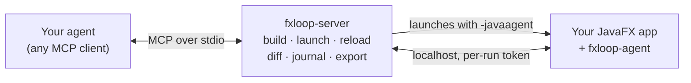

<div align="center">

# FXLoop

**Let your coding agent see, click and fix your JavaFX app.**

FXLoop gives your coding agent a running copy of your JavaFX app to look at and drive, explains why the UI looks the
way it does, and live-reloads the fix. Works with any MCP agent, for Java or Kotlin, Maven or Gradle.

[](LICENSE)


[Quickstart](#quickstart) · [What you can ask](#what-you-can-ask) · [Features](#features) · [Docs](#documentation)

</div>

---

When an agent builds a web app, it has a browser: the DOM, the console, screenshots, clicks. When it builds a JavaFX
app, it writes code, compiles, and asks you what happened on screen. FXLoop closes that loop. It gives the agent a
supervised copy of your app to look at and drive, and the explanations it needs to fix what it finds the first time,
instead of guessing at CSS and layout.

<p align="center">
  
</p>

## Quickstart

**You need** a JDK 17+, a JavaFX app built with Maven or Gradle, and an agent that speaks MCP.

**1. Install the FXLoop skills**, ten workflows your agent picks up from plain requests:

```sh
npx skills add h9lxyz/fxloop -g -y
```

This needs Node.js 22.20+. It installs the skills in your home directory, for every agent it finds.

**2. Open your agent in your app's project and ask:**

> Connect FXLoop to this project and show me the app.

The agent downloads the FXLoop server, registers it and asks you to restart it once. Say "continue" and it launches
your app and shows you a screenshot. The first launch compiles your project, which takes 30 seconds to a few minutes;
after that, answers are instant.

It doesn't change your build files. The few files it does add, such as the agent config and a short note in
`CLAUDE.md` or `AGENTS.md`, stay uncommitted so you can review them.

**No Node.js, or an agent without skills?** Skip step 1 and paste this into your agent. It needs nothing but the JDK:

> Set up FXLoop in this project by following https://raw.githubusercontent.com/h9lxyz/fxloop/main/INSTALL.md

[INSTALL.md](INSTALL.md) is also the guide for doing every step by hand, with the config for each agent. To try FXLoop
on a demo first, use [Ticket Desk](sample-apps/fxloop-showcase-app/README.md#running-a-demo), a small helpdesk app with
UI bugs planted on purpose.

## What you can ask

Once FXLoop is connected, talk to your agent the way you would talk to a colleague looking at your screen:

| You say | What happens |
|---|---|
| "Show me the app" | Launches the app and shares a screenshot |
| "Review this screen, what looks off?" | Ranked findings: truncated text, overlaps, low contrast, misalignment |
| "The panel doesn't resize" / "the buttons are squashed" | Finds the layout cause and fixes it, with before and after screenshots |
| "Make it look modern" / "add dark mode" | Restyles with CSS, reloaded live while you watch |
| "Is this keyboard friendly? Check the contrast" | Walks the Tab order and measures contrast ratios |
| "Does it work at 1024×640? In German? Right-to-left?" | Resizes and relaunches with each setting, and lints every frame |
| "Creating a ticket feels clunky" / "it freezes on refresh" | Clicks through the flow and fixes friction and UI-thread blocking |
| "Clean up this dialog" / "Escape doesn't close it" | Fixes tab order, Enter and Escape, sizing and validation |
| "Make all screens look the same" | Moves shared styles into one stylesheet |
| "Make sure this doesn't regress" | Writes a JUnit 5 + TestFX test from what was clicked |

## Features

| | |
|---|---|
| 👀 **See** | Screenshots of any window or node, with numbered markers. Pixel diffs between frames, hover, focus and pressed states in one image, and the scene graph as JSON. Every screenshot is saved, so you see what the agent saw |
| 🖱️ **Drive** | Real clicks and typing, or synthetic events while you keep using your mouse. Every action reports what changed: a dialog opened, a button got disabled, or nothing happened |
| ❓ **Explain** | Why a node has its size: constraints, grow rules, margins. Why it has its color: the winning CSS rule with `file:line` and the smallest override that beats it. Why it is disabled: the binding chain |
| 🔍 **Catch** | Visual lint for truncated text, overlaps, off-screen and zero-size nodes, and low contrast. FXML checked against your controllers before launch. UI-thread exceptions and logs |
| ⚡ **Reload live** | CSS in milliseconds, FXML swapped in place with state kept, method bodies hot-swapped (Java and Kotlin). Bigger changes restart the app and click back to the same screen |
| 🧪 **Lock in** | Turns what was clicked into a JUnit 5 + TestFX test that runs headless |
| 🤝 **Work alongside you** | A dev bar on the app window shows what the agent is doing. Click **Pick** on a node and ask "why is *this* grey?", or open a DevTools-style CSS inspector in your browser |
| 🔒 **Stay out of production** | Nothing is added to your app or its build. The agent attaches only at dev launch and listens on localhost with a per-run token. If you add the build plugin, a guard fails the package if FXLoop ever leaks in |

There are nearly forty `fx_*` tools; the [MCP server overview](docs/mcp.md) groups them by job, and the
[tool reference](docs/tools.md) lists every parameter.

## Run the app yourself

Prefer to start the app on your own and bring the agent in later? Ask your agent **"I want to run the app myself"**.
It adds the FXLoop build plugin and a guard that keeps FXLoop out of your release builds. Then run:

```sh
./mvnw fxloop:run        # Gradle: ./gradlew fxloopRun
```

Click around, **Pick** the node that bothers you and ask your agent about it. The agent connects to your window instead
of launching a second copy, and it leaves your mouse alone. The [configuration guide](docs/configuration.md#running-the-app-yourself)
has the details, and [INSTALL.md](INSTALL.md#7-add-the-build-plugin-and-the-guard-optional) adds the plugin by hand.

## Troubleshooting

Start with the doctor. Run it in your project, or ask your agent to. It checks your JDK, build, JavaFX setup, main
class, display and agent config, gives a one-line fix for each problem, and changes nothing:

```sh
java -jar "$HOME/.fxloop/fxloop-server.jar" doctor
```

If the `fx_*` tools don't show up, start a new agent session: a running session doesn't see new servers. More answers
are in the [troubleshooting guide](docs/troubleshooting.md).

## How it works



The server builds your project with its own Maven or Gradle wrapper, finds the main class, and launches the app with a
small in-JVM agent. Because the server owns the MCP session, your app can crash, restart or be hot-swapped without
the agent losing its connection.

## Compatibility

| | |
|---|---|
| **Agents** | Claude Code, Cursor, VS Code (Copilot agent mode), Codex CLI, Gemini CLI, any stdio MCP client |
| **Apps** | Java or Kotlin, Maven or Gradle, FXML or code-built UI, classpath or module path |
| **Runtime** | JDK 17+ with JavaFX 21, 25 or 27. JetBrains Runtime unlocks structural hot-swap (new methods and fields) |
| **Displays** | A desktop, or headless on Xvfb or Monocle for SSH, devcontainers and CI ([templates](docs/ci/README.md)) |
| **OS** | Linux is tested in CI; macOS and Windows are configured in CI but not yet run |

FXLoop is at its first `0.0.x` releases. Know the [limitations](docs/limitations.md) before you rely on it.

## Documentation

| Guides | Reference | Design |
|---|---|---|
| [Install (step by step)](INSTALL.md) | [Tool reference](docs/tools.md) | [Architecture](docs/00-overview.md) |
| [MCP server overview](docs/mcp.md) | [Configuration](docs/configuration.md) | [Implementation status](docs/05-implementation-tracking.md) |
| [Agent skills](docs/skills.md) | [Troubleshooting](docs/troubleshooting.md) | [Decisions](docs/decisions/) |
| [CI and headless](docs/ci/README.md) | [Security](docs/security.md), [Limitations](docs/limitations.md) | PRDs in [docs/](docs/) |

## Contributing

Build instructions and the repository layout are in [CONTRIBUTING.md](CONTRIBUTING.md).

## License

Apache-2.0, see [LICENSE](LICENSE).
