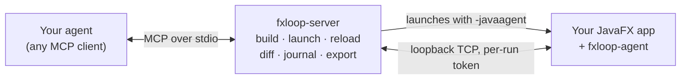

<div align="center">

# FXLoop

**Eyes, ears and hands for coding agents on your JavaFX app.**

FXLoop lets Claude Code, Cursor, Copilot, Codex, Gemini or any other MCP agent see your running JavaFX app, click
through it, explain why it looks the way it does, and live-reload the fix, for Java and Kotlin, Maven and Gradle.

[](LICENSE)


[What it does](#what-it-does) · [Quickstart](#quickstart) · [MCP server](docs/mcp.md) ·
[Agent skills](docs/skills.md) · [Docs](#documentation)

</div>

---

When an agent builds a web app, it has a browser: the DOM, the console, screenshots, clicks. When it builds a JavaFX
app, it writes code, compiles, and asks you what happened on screen. FXLoop closes that loop. It gives the agent a
supervised copy of your app to look at and drive, and the explanations it needs to fix what it finds the first time,
instead of guessing at CSS and layout.

```text
You    The Save button in the contact dialog gets cut off when the window is small.

Agent  fx_take_screenshot annotate=interactive       → screens/14-before-save.png
       fx_lint_visual                                → textTruncated  Button#saveBtn  "Sa…"
       fx_explain_layout #saveBtn                    → in HBox, prefWidth=60 set in FXML, below pref width
       edit contact-dialog.fxml                      → drop prefWidth, HBox.hgrow on the spacer
       fx_reload                                     → tier fxml, swapped live, view state restored
       fx_compare_screenshots before=14 capture=true → 1 changed region, lint clean

       Fixed: #saveBtn had a fixed prefWidth inside an HBox. Before/after frames are in target/fxloop/screens/.
```

<sub>An illustrative session, tool output abbreviated.</sub>

## What it does

| | |
|---|---|
| **See the app** | Screenshots of any window or node, with numbered markers that map to node paths. Pixel diffs between frames, and one-shot strips of a control's hover/focus/pressed/disabled states. The scene graph as compact JSON. Every frame is saved to disk, so you see what the agent saw. |
| **Drive it** | Clicks, typing and key presses through the real mouse and keyboard, or as synthetic events while you use the app yourself. Every action returns a scene diff: the dialog opened, the button got disabled, nothing happened. |
| **Ask why** | Why is this node that size: bounds, min/pref/max, grow, margins and anchors. Why is it this color: the CSS rule that won, with `file:line`, the rules it beat and the smallest override that would win. Why is it disabled: the binding tree. |
| **Catch problems** | Visual lint for truncated text, overlap, zero-size and off-screen nodes and low contrast. FXML lint against your controllers before the app even starts. Uncaught FX-thread exceptions and app logs. |
| **Edit live** | CSS re-applies in milliseconds, FXML swaps in place with selection, scroll and text carried over, method bodies HotSwap (Java and Kotlin), and on JetBrains Runtime so do new methods, lambdas and fields. Anything bigger restarts without rebuilding, since the reload already compiled it, and clicks its way back to the same screen. |
| **Lock it in** | Export what was clicked, by the agent or by you, as a JUnit 5 + TestFX test with real assertions, and run it headless on Monocle. |
| **Work alongside you** | A dev bar on the app window shows what the agent is doing and what needs you. **Pick** a node and ask "why is *this* grey?". **Open CSS inspector** opens a DevTools-style cascade inspector in your browser; under `fxloop:run` (or with `FXLOOP_INSPECTOR_EDIT`) you edit values and add rules there live, then write them into the stylesheet with *Apply to file* or hand them to the agent. When the agent clicks through the UI itself it can lock your input for a moment: the bar says what it is doing and that you are watching, and **Take over** ends it. |
| **Stay out of production** | Nothing is added to your app: the agent is injected with `-javaagent` at dev launch, listens on loopback with a per-run token, and is a no-op without its launch arguments. A build guard fails the package if FXLoop ever leaks in. |

FXLoop comes in two parts. Use the server on its own, or add the skills on top.

### [The MCP server →](docs/mcp.md)

Nearly forty `fx_*` tools for any MCP client. It builds your project, launches the app with a small in-JVM agent,
supervises it across crashes and restarts, and routes your edits through the cheapest reload that works. The
[overview](docs/mcp.md) groups the tools by job and explains run modes, reload tiers and shared control. Every
parameter is in the [tool reference](docs/tools.md).

### [The agent skills →](docs/skills.md)

Ten `SKILL.md` workflows that turn those tools into UI and UX work on your own app. They trigger from plain requests,
and every fix comes with evidence you can check: before/after frames, measured values, lint counts.

| Ask your agent... | Skill |
|---|---|
| "connect FXLoop to this project and show me the app" | `fxloop-connect` |
| "review this screen, what looks off?" | `fxloop-ui-review` |
| "the panel doesn't resize", "the buttons are squashed" | `fxloop-fix-layout` |
| "make it look modern", "add dark mode", "fix the hover state" | `fxloop-style` |
| "is this keyboard friendly? run a contrast check" | `fxloop-accessibility` |
| "does it work at 1024×640? in German? right-to-left?" | `fxloop-responsive` |
| "this flow feels clunky", "it freezes when I click refresh" | `fxloop-flow-polish` |
| "clean up this dialog", "Escape doesn't close it" | `fxloop-forms-dialogs` |
| "make all screens look the same" | `fxloop-consistency` |
| "make sure this doesn't regress" | `fxloop-lock-in` |

## Quickstart

**Requirements**

- JDK 17 or newer on `PATH`: a JDK, not a JRE (`java -version`, and `javac -version` should work).
- A JavaFX app built with Maven or Gradle.
- An agent that speaks MCP.

### Install

One jar in `~/.fxloop/`. No clone, no build. It comes from the latest GitHub release.

```sh
# bash / zsh
mkdir -p ~/.fxloop && curl -fsSL -o ~/.fxloop/fxloop-server.jar \
  https://github.com/h9lxyz/fxloop/releases/latest/download/fxloop-server-all.jar
java -jar ~/.fxloop/fxloop-server.jar --version
```

```powershell
# PowerShell
New-Item -Force -ItemType Directory "$HOME\.fxloop" | Out-Null
Invoke-WebRequest -OutFile "$HOME\.fxloop\fxloop-server.jar" `
  https://github.com/h9lxyz/fxloop/releases/latest/download/fxloop-server-all.jar
java -jar "$HOME\.fxloop\fxloop-server.jar" --version
```

`--version` prints the version and checks your JDK.

**No access to GitHub (proxy, firewall, antivirus quarantine)?** Get `fxloop-server-all.jar` any way you can and put it
at `~/.fxloop/fxloop-server.jar` (`%USERPROFILE%\.fxloop\fxloop-server.jar` on Windows). Nothing else is downloaded.
If the file is missing or the JDK is wrong, `java -jar ~/.fxloop/fxloop-server.jar doctor` says what to fix.

### A. Just the MCP server

Register the jar with your agent. The path is absolute and per machine.

```sh
# bash / zsh
claude mcp add fxloop -- java -jar ~/.fxloop/fxloop-server.jar
```

```powershell
# PowerShell
claude mcp add fxloop -- java -jar "$HOME\.fxloop\fxloop-server.jar"
```

The server runs in the agent's working directory; set `FXLOOP_PROJECT_DIR` (or `project-dir` in `fxloop.properties`)
only when the app is not the workspace root. Configs for Cursor, VS Code, Codex CLI and Gemini CLI are in the
[MCP clients reference](fxloop-skills/skills/fxloop-connect/references/mcp-clients.md).

Then ask your agent to call `fx_get_app_status`: the first call builds the app, launches it and connects. Nothing in
your build file has to change: without the [Maven](fxloop-maven-plugin/README.md) or [Gradle](fxloop-gradle-plugin/README.md)
plugin the server finds the main class and launch mode itself (`prepare: server` in the status). When several classes
could be the main class, the error lists them; pin one with `main-class=<fqcn>` in `fxloop.properties`.

### B. With the skills (recommended)

Path A plus the skill folders. `fxloop-connect` adds the build plugin, a production guard and notes for the agent.

```sh
# bash / zsh
curl -fsSL -o /tmp/fxloop-skills.zip \
  https://github.com/h9lxyz/fxloop/releases/latest/download/fxloop-skills.zip \
  && unzip -o /tmp/fxloop-skills.zip -d ~/.claude/skills/     # Claude Code; other agents: their skills directory
```

```powershell
# PowerShell
Invoke-WebRequest -OutFile "$env:TEMP\fxloop-skills.zip" `
  https://github.com/h9lxyz/fxloop/releases/latest/download/fxloop-skills.zip
Expand-Archive -Force "$env:TEMP\fxloop-skills.zip" "$HOME\.claude\skills\"
```

Then, in your app's project, ask: **"connect FXLoop to this project and show me the app"**. `fxloop-connect` checks
your JDK, downloads the server jar if it isn't there, registers it for your agent, adds the build plugin and the
guard, asks you to reload the agent's MCP servers once, then launches the app and shows a screenshot. After that, just
describe what you want.

### Run the app yourself, bring the agent in later

Needs the build plugin in your project (path B adds it; or copy the snippet from the
[Maven](fxloop-maven-plugin/README.md) or [Gradle](fxloop-gradle-plugin/README.md) plugin README).

```sh
mvn fxloop:run        # or: gradle fxloopRun
```

Until the plugins are on Maven Central and the Gradle Plugin Portal, run `java -jar ~/.fxloop/fxloop-server.jar
--seed-local-repo` once. It writes the plugin and agent into `~/.m2/repository/dev/fxloop/` (Gradle projects also need
`mavenLocal()` in `pluginManagement`).

Your app starts with the dev bar. Click around, **Pick** the node that bothers you, then ask your agent. It finds the
running app on its first call, connects instead of launching another copy, and leaves your mouse alone. Close the app
and the agent's next `fx_start_app` launches a supervised copy that it can restart itself
([details](docs/configuration.md#running-the-app-yourself)).

## How it works



The server owns the MCP session and runs your app as a child process, so the app can crash, restart or be hot-swapped
without the agent losing its connection. The in-JVM agent stays thin: it runs requests on the FX thread and reports
back. Diffing, compiling, journaling and test generation happen in the server.

## Works with

| | |
|---|---|
| **Agents** | Claude Code, Cursor, VS Code (Copilot agent mode), Codex CLI, Gemini CLI, any stdio MCP client |
| **Apps** | Java or Kotlin, Maven or Gradle, FXML or code-built UI, classpath or module path |
| **Runtime** | JDK 17+ with JavaFX 21, 25 or 27 (your app's own; 25 needs JDK 23+, 27 needs JDK 25+), all tested in CI. Launch on JetBrains Runtime and structural hot-swaps are enabled automatically |
| **Displays** | A real desktop, or headless on Xvfb or Monocle for devcontainers, SSH and CI ([templates](docs/ci/README.md)) |
| **Ways to connect** | Launched by the server, run by you (`fxloop:run`, `fxloopRun`), started from your IDE with `fxloop-dev`, or attached to any local JavaFX JVM by pid |

## Status

FXLoop is at its first `0.0.x` releases. Per-feature status is in the
[implementation tracking](docs/05-implementation-tracking.md). Still open: publishing to Maven Central and the Gradle
Plugin Portal, and CI runs on macOS and Windows (configured, not yet run). Know the edges before you rely on it:
[limitations](docs/limitations.md).

## Documentation

| Start here | Reference | Design |
|---|---|---|
| [MCP server overview](docs/mcp.md) | [Tool reference](docs/tools.md) | [Overview and architecture](docs/00-overview.md) |
| [Agent skills overview](docs/skills.md) | [Configuration](docs/configuration.md) | PRDs: [PoC](docs/01-prd-poc.md), [MVP](docs/02-prd-mvp.md), [production](docs/03-prd-production.md), [visual feedback](docs/04-prd-visual-feedback.md), [skills](docs/06-prd-skills.md), [live dev loop](docs/07-prd-live-dev.md), [CSS inspector](docs/08-prd-css-inspector.md) |
| [Skills install and layout](fxloop-skills/README.md) | [Limitations](docs/limitations.md) | Decisions: [FXML load registry](docs/decisions/fxml-load-registry.md), [Kotlin](docs/decisions/kotlin.md), [live dev loop](docs/decisions/live-dev-loop.md), [CSS inspector contract](docs/decisions/css-inspector-contract.md), [skills packaging](docs/decisions/skills-packaging.md) |
| [CI templates](docs/ci/README.md), [Monocle](docs/ci/monocle.md) | [Security](docs/security.md), [Troubleshooting](docs/troubleshooting.md) | |

Browse it as a site with `mkdocs serve` (see `mkdocs.yml`).

## Repository layout

<details>
<summary>Modules</summary>

| Module | What it is |
|---|---|
| `fxloop-protocol` | FCP (FXLoop Control Protocol) DTOs, NDJSON codec, error codes, token and handshake helpers, the `launch.json` schema |
| `fxloop-agent` | The in-JVM agent (`-javaagent` or attach): scene graph, input, reload, FXML registry. ByteBuddy, Jackson and the Kotlin stdlib are relocated |
| `fxloop-dev` | Optional dev dependency for IDE-launched apps (`FxLoopDev.install/view/onReload`); see the [decision](docs/decisions/fxml-load-registry.md) |
| `fxloop-server` | The stdio MCP server (shaded `-all.jar`): builds, launches, supervises, reloads |
| `fxloop-maven-plugin` | `fxloop:run` and `fxloop:prepare` ([README](fxloop-maven-plugin/README.md)) |
| `fxloop-gradle-plugin` | Gradle plugin `dev.fxloop` with `fxloopRun` and `fxloopPrepare`; a standalone Gradle build ([README](fxloop-gradle-plugin/README.md)) |
| `fxloop-skills` | The agent skills, shared references and skill evals ([README](fxloop-skills/README.md)) |
| `sample-apps/*` | Test targets: `fxloop-sample-app` (contacts), `fxloop-gauntlet-app` (dialogs, menus, tabs and more), `fxloop-sample-app-gradle`, `fxloop-sample-app-kotlin`, and `fxloop-showcase-app`, a Kotlin helpdesk with planted UI and UX issues for trying the skills |
| `fxloop-acceptance` | End-to-end suite that drives the server over MCP (`-Pacceptance`) |

The tooling is written in Kotlin and targets Java 17 bytecode. The apps it drives are ordinary Java or Kotlin JavaFX
projects.

</details>

## Contributing

### Build and test

```sh
./mvnw install                  # the FXLoop modules; UI tests run headless on Monocle, no display needed
./mvnw install -Psamples        # plus the sample and gauntlet apps and their tests (what CI builds)
./mvnw install -Pacceptance     # plus the end-to-end MCP suite
```

`docs/tools.md` is generated from the tool registry (`java -jar fxloop-server/target/fxloop-server-*-all.jar
--tool-reference`); don't edit it by hand.

### Build from source

For working on FXLoop, not for using it:

```sh
# bash / zsh
git clone https://github.com/h9lxyz/fxloop.git && cd fxloop
./mvnw install -DskipTests
(cd fxloop-gradle-plugin && ./gradlew publishToMavenLocal)   # only for Gradle apps against a local build
```

```powershell
# PowerShell
git clone https://github.com/h9lxyz/fxloop.git; cd fxloop
.\mvnw.cmd install -DskipTests
cd fxloop-gradle-plugin; .\gradlew.bat publishToMavenLocal; cd ..
```

Your build is then `fxloop-server/target/fxloop-server-1.0.0-SNAPSHOT-all.jar`; register that path instead of
`~/.fxloop/fxloop-server.jar`. The skills install from `fxloop-skills/skills/fxloop-*` by copying the folders into your
agent's skills directory.

With [jbang](https://www.jbang.dev): `jbang-catalog.json` defines the alias `fxloop`, so after `./mvnw install`,
`jbang fxloop@<path-to-this-repo>` runs the server.

## License

Apache-2.0, see [LICENSE](LICENSE).
